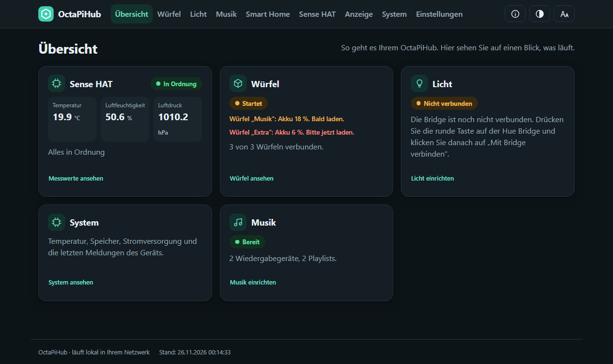
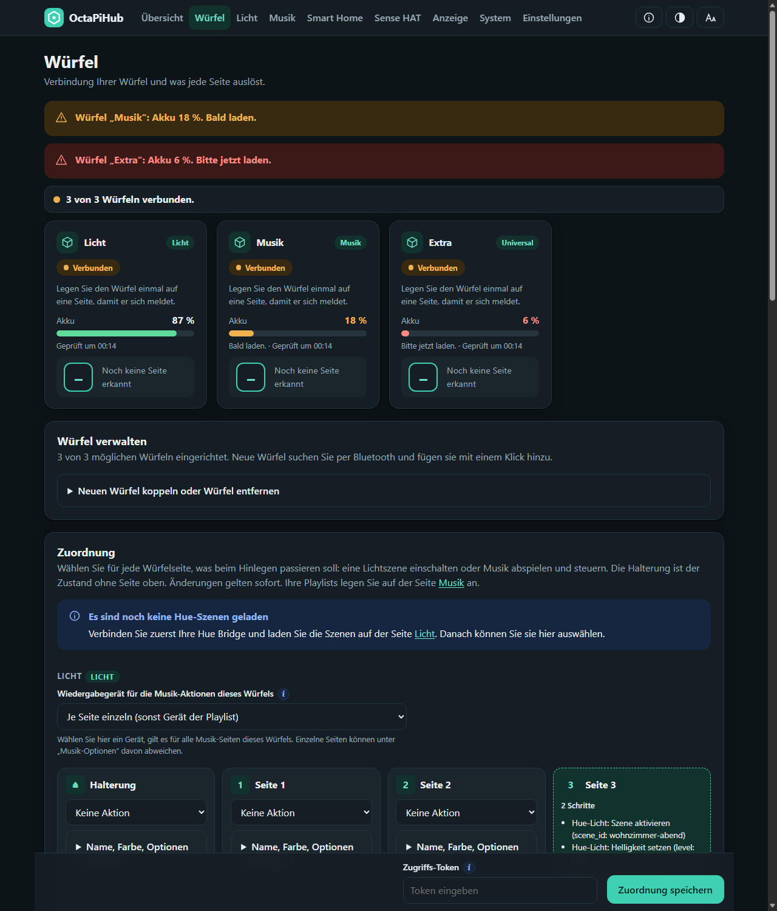
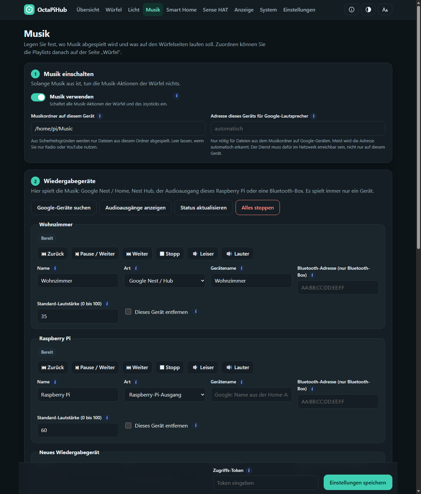
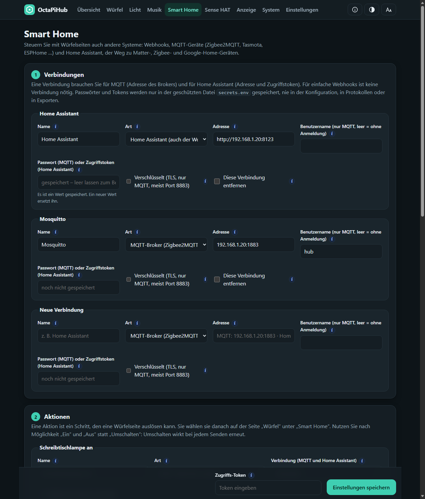
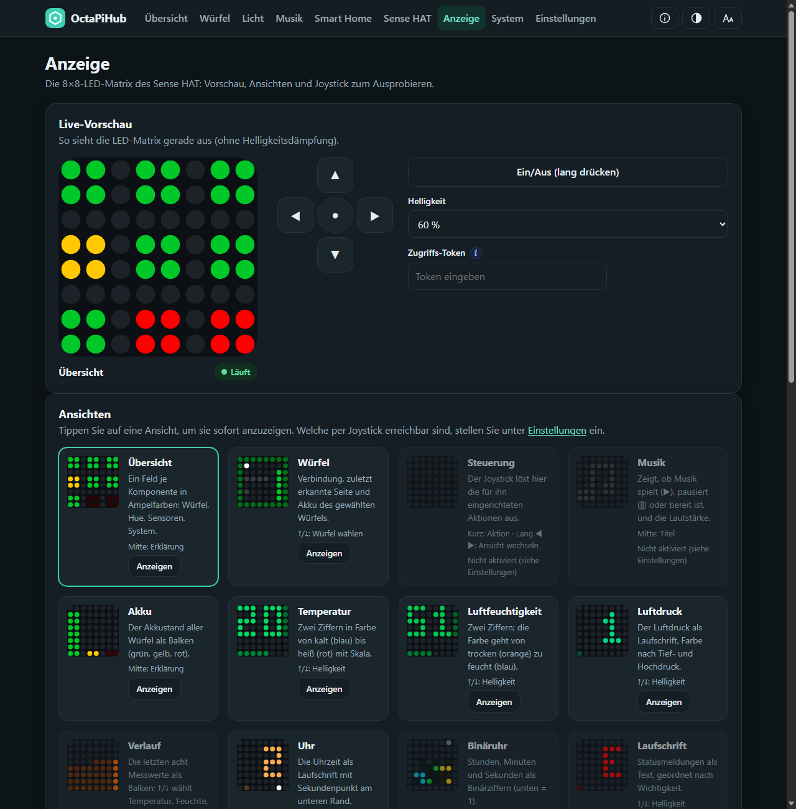
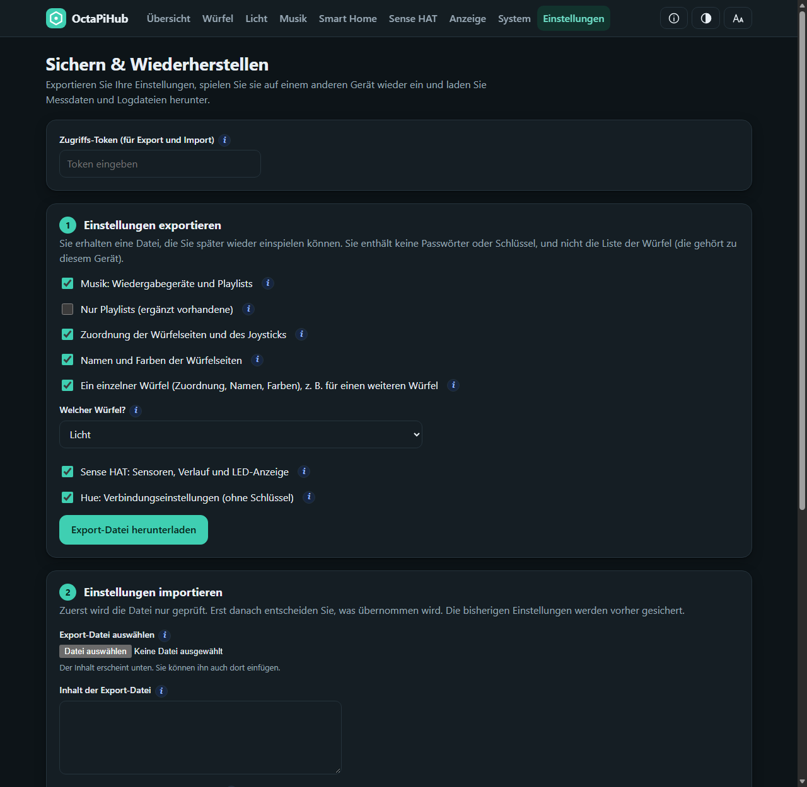
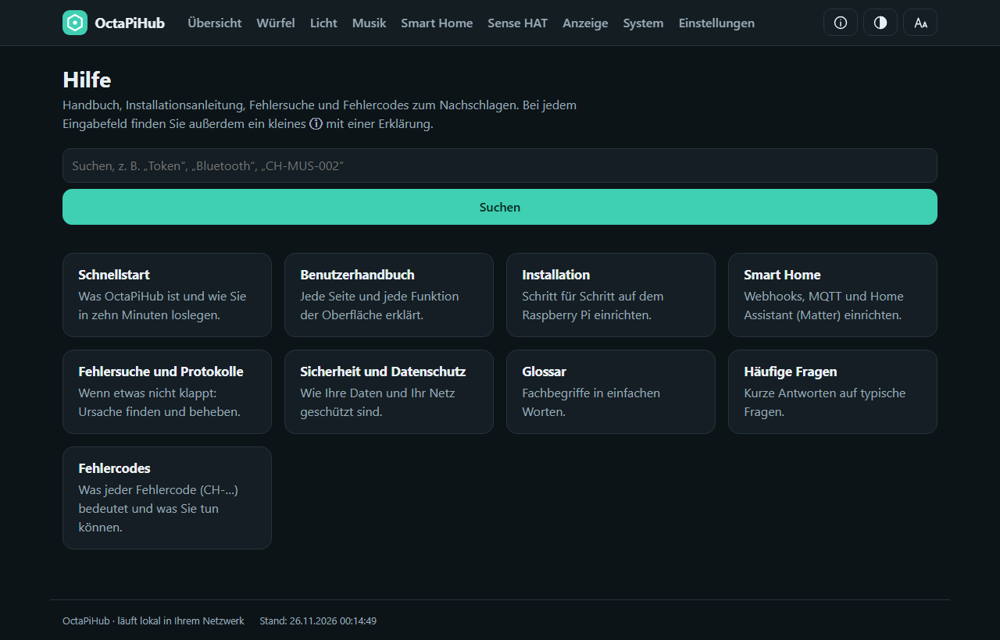

# OctaPiHub

**Eine lokale Schaltzentrale für Ihr Zuhause, gesteuert mit Würfeln.** OctaPiHub läuft auf einem Raspberry Pi und löst **Licht, Musik und andere Smart-Home-Aktionen** aus, wenn Sie einen Timeular-/ZEI-Würfel auf eine Seite legen. Jede der acht Seiten, die Halterung und die Richtungen des Sense-HAT-Joysticks können eine eigene Aktion haben. Bedient wird alles im Browser.

Alles läuft **lokal in Ihrem Heimnetz**: kein Konto, keine Cloud von OctaPiHub, keine Telemetrie. Das Projekt ist eigenständig (kein Teil von OctaLedger oder Timeular).

> ## Ehrlicher Stand
> Die Software ist **vollständig implementiert und automatisiert getestet (über 1600 Tests)**, aber bisher **ausschließlich mit Simulationen**: Fake-Würfel, Fake-Sense-HAT, Fake-Lautsprecher, lokale Test-Server für die Hue Bridge, Home Assistant und Webhooks, ein Test-Broker für MQTT. **Nichts wurde bisher mit echter Hardware geprüft** (weder Würfel, Raspberry Pi, Sense HAT, Hue Bridge, Google-Lautsprecher, mpv, Bluetooth-Box noch MQTT-Broker). Die Installationsanleitung enthält eine Prüfliste, um das nachzuholen. Nach Nutzerangabe wurde im separaten Projekt OctaLedger ein echter Würfel mit einem Musikplayer erprobt; das belegt weder OctaPiHub-Bluetooth noch die übrigen Funktionen.

## Inhalt
1. [Was kann OctaPiHub?](#was-kann-octapihub)
2. [So sieht es aus](#so-sieht-es-aus)
3. [Schnellstart zum Ausprobieren (ohne Hardware)](#schnellstart-zum-ausprobieren-ohne-hardware)
4. [Installation auf dem Raspberry Pi](#installation-auf-dem-raspberry-pi)
5. [Bedienung in Kürze](#bedienung-in-kürze)
6. [Funktionen im Detail](#funktionen-im-detail)
7. [Konfiguration](#konfiguration)
8. [Fehlerbehandlung und Protokolle](#fehlerbehandlung-und-protokolle)
9. [Sicherheit und Datenschutz](#sicherheit-und-datenschutz)
10. [Aufbau der Software](#aufbau-der-software)
11. [Entwicklung und Tests](#entwicklung-und-tests)
12. [Grenzen und Ausblick](#grenzen-und-ausblick)
13. [Dokumentation](#dokumentation)

## Was kann OctaPiHub?
| Bereich | Fähigkeiten |
|---|---|
| **Würfel** | Bis zu **3 Würfel** per Bluetooth LE; Verbindungsstatus, Akkustand, aktive Seite live; **neue Würfel per Bluetooth-Suche koppeln**; Halterung (Würfel senkrecht) als eigener Zustand; Entprellung |
| **Seiten programmieren** | Jede Seite, die Halterung und jede Joystick-Richtung: **Name, Farbe, Aktion**; Klartext, was genau passiert; die aktive Seite wird hervorgehoben; Belegung **exportieren und auf einen anderen Würfel importieren** |
| **Licht (Philips Hue)** | Szenen, **Ein/Aus/Umschalten, Heller/Dunkler, Farbe setzen, nächste Farbe, nächste/vorherige Szene** – je Raum oder für das ganze Haus |
| **Musik** | **Google Nest / Home / Nest Hub** (Cast), **Audioausgang des Raspberry Pi**, **Bluetooth-Box**; Ordner, Dateien, m3u/pls, Radio, YouTube (auch YouTube Music); **Zufall, ganze Playlist oder Titel wiederholen**; Gerät je Würfel oder Seite |
| **Smart Home** | **Webhooks**, **MQTT** (Zigbee2MQTT, Tasmota, ESPHome …) und **Home Assistant** – damit auch **Matter**- und Google-Home-Geräte |
| **Sense HAT** | Temperatur (mit Korrektur), Luftfeuchtigkeit, Luftdruck u. a.; Verlauf und Diagramme; **21 LED-Ansichten** (Übersicht, Würfel, Akku, Musik, Uhr, Kompass, Wasserwaage …); Joystick als Steuerung und Aktionsquelle |
| **Weboberfläche** | Hell/Dunkel/Automatisch, zwei Schriftgrößen, Handy-tauglich, Live-Aktualisierung; **ⓘ-Hilfe an jedem Eingabefeld**; eingebaute **Hilfe mit Suche** und **Fehlercodes** |
| **Verwaltung** | Speichern, Laden, **Export/Import** von Einstellungen, Playlists und einzelnen Würfeln; **CSV-Export** der Sensordaten; Log-Download; Diagnose-Paket |
| **Zuverlässigkeit** | Aktionswarteschlange je Würfel (Wiederholung, Pausen, Ablauf), **Fehlerisolierung**, Fallback auf Sicherungen, abgesicherter Start, `/healthz` |

## So sieht es aus
Die Bilder zeigen den **Demo-Modus** (simulierte Werte), nicht echte Hardware.

| | |
|---|---|
|  **Übersicht:** Zustand von Sense HAT, Würfeln, Licht, Musik und System auf einen Blick. |  **Würfel:** Verbindungsstatus, Akku, Würfel koppeln, Seiten programmieren. |
|  **Musik:** Wiedergabegeräte (Google Nest, Pi, Bluetooth), Playlists, Steuerung. |  **Smart Home:** MQTT, Home Assistant und Webhooks. |
|  **Anzeige:** Live-Vorschau der LED-Matrix, alle 21 Ansichten, virtueller Joystick. |  **Sichern & Wiederherstellen:** Export/Import, CSV, Logs. |
|  **Hilfe:** Handbuch, Installation, Fehlersuche, Fehlercodes – mit Suche. | |

## Schnellstart zum Ausprobieren (ohne Hardware)
Voraussetzung: **Python 3.12 oder neuer**.

```bash
git clone <Ihr-Repository> OctaPiHub && cd OctaPiHub
python -m venv .venv
.venv/bin/pip install -e ".[dev,music]"     # Windows: .venv\Scripts\pip
.venv/bin/python -m octapihub.web --demo --port 8080
```
Dann `http://127.0.0.1:8080` öffnen; das Token im Demo-Modus ist **`demo`**. Der Demo-Modus zeigt simulierte Werte, drei simulierte Würfel mit Akkustand, eine simulierte Hue Bridge, Fake-Lautsprecher, einen Fake-Bluetooth-Scanner und Beispiel-Smart-Home-Aktionen. Nichts verlässt den Rechner und nichts davon ist eine Messung.

## Installation auf dem Raspberry Pi
Die vollständige, nummerierte Anleitung (Betriebssystem, Benutzer, Programm, Würfel finden, Token, systemd-Dienst, Musik, Sichern, Aktualisieren, Hardware-Prüfliste, Fehlertabelle) steht in **[deploy/INSTALL.md](deploy/INSTALL.md)**. Kurzfassung:

```bash
sudo apt install -y python3 python3-venv python3-pip git bluez mpv yt-dlp alsa-utils
sudo useradd --system --create-home --home-dir /var/lib/octapihub --shell /usr/sbin/nologin octapihub
sudo usermod -aG bluetooth,i2c,input,audio octapihub
sudo git clone <Ihr-Repository> /opt/octapihub
sudo python3 -m venv /opt/octapihub/venv
sudo /opt/octapihub/venv/bin/pip install "/opt/octapihub[music]"
# Konfiguration und Token anlegen, dann:
sudo cp /opt/octapihub/deploy/octapihub.service /etc/systemd/system/ && sudo systemctl enable --now octapihub
```
Dateien in [deploy/](deploy/): systemd-Dienst (gehärtet), Beispielkonfiguration, Umgebungsdatei, Anleitung. **Auf einem echten Raspberry Pi wurde das noch nicht ausprobiert.**

## Bedienung in Kürze
1. Im Browser `http://<Adresse-des-Pi>:8080` öffnen. Lesen ist frei, **Ändern braucht das Zugriffs-Token**.
2. **Würfel** → *Würfel verwalten* → *Nach Würfeln suchen* → hinzufügen.
3. **Licht**: Bridge eintragen, Taste drücken, koppeln. **Musik**: Gerät und Playlist anlegen. **Smart Home**: Verbindungen und Aktionen anlegen.
4. **Würfel** → pro Seite eine Aktion wählen, optional Name und Farbe → *Zuordnung speichern*. Sie gilt sofort.
5. Würfel auf die Seite legen. Fertig.

## Funktionen im Detail
### Würfel und Seiten
Ein Würfel hat acht Seiten (1 bis 8) und die **Halterung** (Seite 0: er steht senkrecht, keine Seite eindeutig oben). Die erste Meldung nach dem Verbinden löst nichts aus (Baseline); schnelles Kippen zählt nur einmal (Entprellung, einstellbar). Pro Seite wählen Sie Aktion, **Name** (bis 40 Zeichen) und **Farbe**; ein Klartext-Bereich zeigt, was genau passiert (Quelle, Ordner, Gerät, Zufall/Wiederholen, Lautstärke, Raum, Ziel). Mit **Jetzt auslösen** testen Sie ohne Würfel. Der **Joystick** hat fünf weitere „Seiten“ (hoch, rechts, runter, links, Mitte) und löst sie in der LED-Ansicht „Steuerung“ aus.

### Licht
Hue wird lokal über die CLIP-v2-Schnittstelle angesprochen (geprüftes TLS, Kopplung per Knopfdruck, Schlüssel in `secrets.env`). Aktionen: Szene, Ein/Aus/Umschalten, Heller/Dunkler (`dimming_delta`), Farbe setzen (Weißtöne und 8 Farben), nächste Farbe, nächste/vorherige Szene eines Raums. Räume und Zonen werden als Lichtgruppen gelesen.

### Musik
| Ziel | Technik |
|---|---|
| Google Nest / Home / Nest Hub | `pychromecast` (optional: `pip install ".[music]"`); lokale Dateien über ablaufende, zufällige Adressen (`/media/<Token>`) |
| Raspberry-Pi-Ausgang, Bluetooth-Box | `mpv` (JSON-IPC), `yt-dlp` für YouTube; Bluetooth-Verbindung per `bluetoothctl` |
Quellen: Ordner/Dateien/m3u/pls **nur aus dem Musikordner**, Radio-Adressen, YouTube-Links. **Zufall** und **Wiederholen** (aus / ganze Playlist / einzelner Titel) je Playlist und je Würfelseite; **Gerät** je Würfel oder Seite. Es spielt immer nur ein Gerät. **Spotify** wird erkannt, ist aber nicht abspielbar (technische und rechtliche Gründe).

### Smart Home
| Weg | Für | Besonderheit |
|---|---|---|
| **Webhook** | Shelly, Tasmota, WLED, ESPHome, Node-RED, eigene Skripte | keine Weiterleitungen, kein Proxy, nur http(s), Link-lokale Adressen gesperrt |
| **MQTT** | Zigbee2MQTT, Tasmota, ESPHome, Node-RED | eigener MQTT-3.1.1-Publisher (QoS 0/1, TLS, Anmeldung), keine zusätzliche Bibliothek |
| **Home Assistant** | **Matter**, Zigbee, Google Home, KNX … | Dienstaufruf über die REST-Schnittstelle mit langlebigem Token |
Passwörter und Tokens liegen nur in `secrets.env`. Wiederholt wird **nur**, wenn sicher nichts gesendet wurde: Ein zweites „Umschalten“ soll ein Gerät nicht zurückschalten. **Matter** wird nicht direkt gesprochen (ein Controller ist ein eigenes Programm); der Weg führt über Home Assistant. **CoAP** wird nicht unterstützt.

### Sense HAT und LED-Anzeige
Messwerte mit Intervall je Sensorgruppe, Temperaturkorrektur neben dem Rohwert, SQLite-Verlauf mit Aufbewahrung, Diagramme (1 Stunde bis 30 Tage). Die 8×8-LEDs zeigen eine von **21 Ansichten** (Übersicht, Würfel, Steuerung, Musik, Akku, Temperatur, Luftfeuchtigkeit, Luftdruck, Verlauf, Uhr, Binäruhr, Laufschrift, Kompass, Wasserwaage, Umgebungsfarbe, Lampe, Regenbogen, Atmen, Farbpalette, Helligkeit, Aus); Nachtmodus, Umgebungshelligkeit und Drehung einstellbar. Joystick: ◀ ▶ Ansicht, ▲ ▼ Auswahl/Helligkeit, Mitte = Erklärung, lange Mitte = aus/ein.

### Speichern, Laden, Export, Import
Einstellungen werden **atomar** gespeichert (ganz oder gar nicht). *Sichern & Wiederherstellen* exportiert Musik, Playlists, Zuordnung, Namen/Farben, **einen einzelnen Würfel**, Sense HAT und Hue-Einstellungen als JSON **ohne Schlüssel**; der Import prüft erst und übernimmt dann **alles oder nichts** mit Sicherungskopie. Dazu CSV-Export der Sensordaten und Log-Download.

## Konfiguration
Eine versionierte TOML-Datei (`octapihub.toml`, **Schema v7**; ältere Versionen werden gelesen und migriert). Alles ist auch in der Oberfläche einstellbar. Beispiel: [deploy/octapihub.toml.example](deploy/octapihub.toml.example).

| Abschnitt | Inhalt |
|---|---|
| `[bluetooth]`, `[[cubes]]` | Adapter, 1–3 Würfel (Name, Adresse, Verwendung) |
| `[[mappings]]` | Würfel × Seite → Aktionen (Plugin, Aktion, Parameter) |
| `[[face_labels]]` | Namen und Farben der Seiten |
| `[hue]` | Bridge-Adresse, Port, Zertifikat |
| `[music]`, `[[music.targets]]`, `[[music.playlists]]` | Musikordner, Geräte, Playlists |
| `[smarthome]` | Verbindungen und Aktionen (MQTT, Home Assistant, Webhook) |
| `[sense_hat]` | Sensoren, Verlauf, LED-Anzeige, Joystick |

**Geheimnisse** (Hue-Schlüssel, MQTT-Passwörter, Home-Assistant-Token) stehen **nie** in dieser Datei, sondern in `secrets.env` (Rechte 0600). Das Zugriffs-Token der Oberfläche steht in `octapihub.env`.

**Befehlszeile** (`octapihub` bzw. `python -m octapihub.web`):
| Option | Wirkung |
|---|---|
| `--config`, `--secrets`, `--data-dir` | Pfade der Konfiguration, der Zugangsdaten und des Datenordners |
| `--host`, `--port` | Bindeadresse (Standard nur `127.0.0.1`) und Port (8080); auch `OCTAPIHUB_HOST`, `OCTAPIHUB_PORT` |
| `--log-level`, `--log-dir` | Ausführlichkeit (auch `OCTAPIHUB_LOG_LEVEL`) und Logordner |
| `--check` | Einstellungen und Zugangsdaten prüfen und beenden (0 in Ordnung, 1 Warnungen, 2 unbrauchbar) |
| `--demo` | Simulation ohne Hardware, Token `demo` |

## Fehlerbehandlung und Protokolle
- **Fehlerisolierung:** Fällt ein Teil aus (Sense HAT, Lautsprecher, Bridge, Würfel), laufen die anderen weiter. Beim Start wird jeder Dienst einzeln gestartet; scheitert einer, zeigt ein Banner den Grund.
- **Aktionswarteschlange (SQLite, WAL):** je Würfel in Reihenfolge; wachsende Pausen, Ablaufzeit (Musik 60 s, Licht/Smart Home 120 s, sonst 15 Minuten), **keine doppelte Wirkung**: nur sicher unzugestellte Aktionen werden wiederholt.
- **Fehlercodes:** Jede Meldung trägt einen Code (`CH-MUS-002` …). Die Oberfläche erklärt jeden unter **Hilfe → Fehlercodes** (Bedeutung, Abhilfe, ob wiederholt wird). Ein Test stellt sicher, dass jeder Code in der Software auch im Katalog steht.
- **Fallbacks:** Unbrauchbare Konfiguration beim Start → neueste gültige Sicherung; ein unerwarteter Web-Fehler → ruhige Seite mit Kennung (`CH-WEB-500`) statt Absturz; Hardware fehlt → degradierter Betrieb.
- **Logging:** Konsole/journald, die letzten 500 Meldungen in der Oberfläche, **rotierende Logdatei** (`<Datenordner>/logs/octapihub.log`, ca. 6 MB). Zugangsdaten sind unkenntlich, Bluetooth-Adressen gekürzt, Ausnahmetexte werden nicht protokolliert. Nicht abgefangene Fehler in Threads und Hintergrundaufgaben werden protokolliert.
- **Gesundheit:** `/healthz` (ohne Token, ohne Geheimnisse) meldet je Teil `ok` oder `degraded` – für Überwachung.
- **Diagnose-Paket:** ZIP ohne Geheimnisse (Seite *System*).

## Sicherheit und Datenschutz
Keine Cloud, keine Telemetrie. Standardmäßig lauscht der Dienst nur auf `127.0.0.1`; **keine Ports im Router freigeben**. Änderungen brauchen ein langes Token (der Dienst startet nicht mit einem kurzen oder Platzhalter-Token). Strenge Content-Security-Policy, Pfade nur im Musikordner, Weiterleitungen werden nie verfolgt, Link-lokale Adressen gesperrt, `systemd`-Härtung. Die Oberfläche ist **unverschlüsselt (HTTP)** und hat keine Benutzerkonten; für Fernzugriff ein VPN nutzen. Details: [Sicherheit und Datenschutz](src/octapihub/web/help/sicherheit.md).

## Aufbau der Software
Schichten mit klarer Abhängigkeitsrichtung (Details in [docs/ARCHITEKTUR.md](docs/ARCHITEKTUR.md)):
```text
domain  <-  application  <-  infrastructure (Adapter)
   ^             ^                  ^
   +-------------+------------------+
                 core
web  (FastAPI + Jinja2 + SSE, vanilla JS)   composition.py  (verdrahtet alles)
```
| Ordner | Inhalt |
|---|---|
| `core/` | Konfiguration (Schema, Validierung, atomares Speichern), Fehler, **Fehlerkatalog**, Logging, Ausfallsicherheit |
| `domain/` | Würfelereignisse, Entprellung, Wiederverbindung |
| `application/` | Regeln, Aktionswarteschlange, Dienste (Würfel, Hue, Musik, Smart Home, Sense HAT, LED-Anzeige), Export/Import |
| `infrastructure/` | Adapter: Bleak/BlueZ, Hue, Cast, mpv, MQTT/HTTP, Sense HAT, SQLite, Secrets – jeweils mit Fake für Tests |
| `web/` | Seiten, Formulare, Hilfe, Vorlagen (Jinja2), statische Dateien |
Neue Aktionsarten sind **Plugins** (`kind` + `execute(action, parameters)`); Hue, Musik und Smart Home sind solche Plugins.

## Entwicklung und Tests
```bash
python -m pip install -e ".[dev,music]"
python -m pytest                       # alle Tests
python -m ruff check . && python -m ruff format --check .
python -m mypy                         # strikte Typprüfung
```
Alle Hardware- und Netzwerkzugriffe liegen hinter Schnittstellen und haben Fakes; die Tests laufen deshalb ohne Geräte (über 1600 Tests). Tests prüfen unter anderem: Fehlerkatalog vollständig, jedes Eingabefeld hat einen Hilfetext, jedes Dokument ist erreichbar und seine Verweise stimmen, Geheimnisse tauchen nirgends auf, jeder Fehlerpfad der Aktionen hat die richtige Wiederholungs-Semantik. Die Pflicht-Dokumente (Pflichtenheft mit Commit-Nachweis) liegen im Repository.

## Grenzen und Ausblick
**Nicht umgesetzt / bekannte Grenzen**
- **Keine Prüfung mit echter Hardware** (siehe oben). Ungeprüft sind insbesondere: Bluetooth-Verhalten der Würfel (inkl. Akku-Merkmal), Joystick-Richtungen bei gedrehter Anzeige, mpv-Einstellungen (Zufall bei YouTube), Bluetooth-Box-Audio über PipeWire/PulseAudio, Cast-Verhalten, Hue-Gruppen und `dimming_delta`.
- **Spotify** ist nicht abspielbar. YouTube-Playlists auf Google-Geräten lassen sich nicht mischen.
- **Matter direkt** und **CoAP** werden nicht gesprochen (Weg: Home Assistant bzw. Webhook/MQTT).
- Bilder und Dashboards auf Nest-Hub-Displays sind **nicht umgesetzt**.
- Keine Verzögerungs-Schritte („nach 2 s“) in der Zuordnung; mehrere Schritte je Seite nur in der Datei.
- Oberfläche ohne Verschlüsselung und ohne Benutzerkonten.

**Geplant:** Bilder auf Nest-Hub-Displays, Gerätegruppen, weitere Plugins, ein Backup-Skript. Siehe Pflichtenheft.

## Dokumentation
| Dokument | Inhalt |
|---|---|
| [Installation](deploy/INSTALL.md) | Schritt für Schritt auf dem Raspberry Pi, Prüfliste, Fehlertabelle |
| [Benutzerhandbuch](src/octapihub/web/help/handbuch.md) | Jede Seite und Funktion der Oberfläche |
| [Smart Home](src/octapihub/web/help/smarthome.md) | Webhook, MQTT, Home Assistant, Matter |
| [Fehlersuche](src/octapihub/web/help/fehlersuche.md) | Ursachen, Protokolle, Gesundheitsstatus |
| [Sicherheit](src/octapihub/web/help/sicherheit.md) · [Glossar](src/octapihub/web/help/glossar.md) · [FAQ](src/octapihub/web/help/faq.md) | |
| [Architektur](docs/ARCHITEKTUR.md) | Schichten, Entwurfsentscheidungen, Fehlerbehandlung |
| [Pflichtenheft](PFLICHTENHEFT_OctaPiHub-Raspberry-Pi.md) | Anforderungen und **Commit-Nachweis** |
| [Hardware-Einrichtung](HANDBUCH_OctaPiHub-Raspberry-Pi.md) | Hintergrund zu SD-Karte, WLAN, Bluetooth, Sense HAT |
| [Recherche](RECHERCHE_OctaPiHub-Raspberry-Pi.md) | Offene Fragen und Quellen |
Dieselben Handbücher stehen **in der Oberfläche unter „Hilfe“** zum Nachschlagen (mit Suche und Fehlercodes).

## Lizenz
Eine Lizenz ist noch nicht gewählt; vor einer Veröffentlichung müssen Lizenz und Rechte an übernommenem Code geklärt werden. Geheimnisse und persönliche Betriebsdaten gehören nicht in das Repository.
